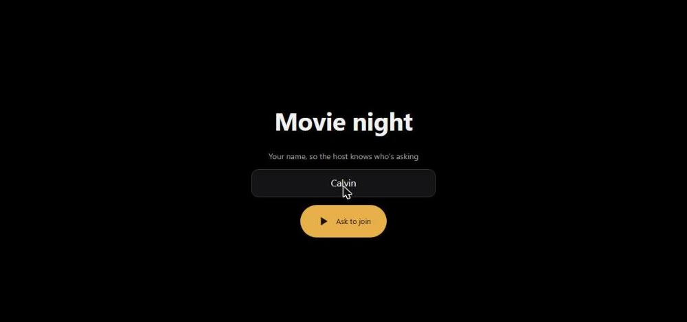
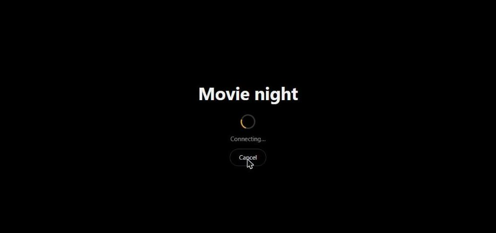
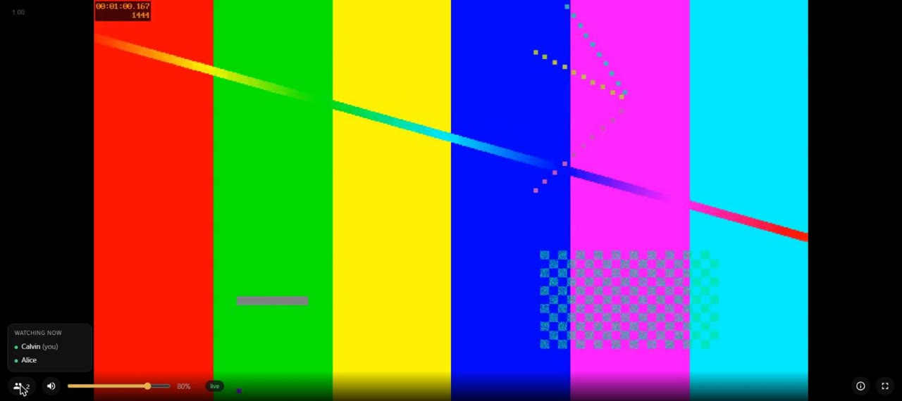
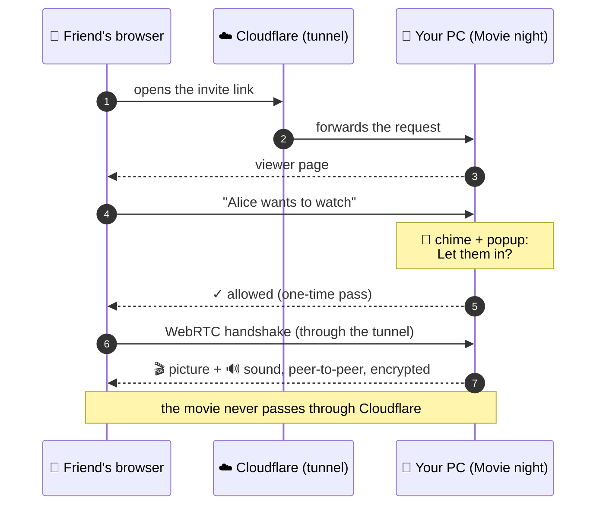

<div id="top" align="center">


# 🍿 Movie night 🍿

### *Watch movies with your friends, right in their browser.*

<em>Share your screen and sound with one link. You decide who gets in. Friends just press play.</em>

<br><br>

<a href="https://github.com/calvinsuzuki/movie-night-server/releases/latest"></a>
<a href="https://github.com/calvinsuzuki/movie-night-server/releases"></a>
<br>


<br><br>

🍿 &nbsp;·&nbsp; 🎬 &nbsp;·&nbsp; 🍿 &nbsp;·&nbsp; 🎞️ &nbsp;·&nbsp; 🍿 &nbsp;·&nbsp; 🎥 &nbsp;·&nbsp; 🍿 &nbsp;·&nbsp; 🎟️ &nbsp;·&nbsp; 🍿

</div>

<br>

## 🍿 Quick links

- [🎬 Overview](#-overview)
- [✨ Features](#-features)
- [🧠 How it works](#-how-it-works)
- [🚀 Getting started](#-getting-started)
- [🎛️ The popcorn menu](#%EF%B8%8F-the-popcorn-menu)
- [⚙️ Configuration](#%EF%B8%8F-configuration)
- [🛟 Troubleshooting](#-troubleshooting)
- [🎨 Palette](#-palette)
- [🗂️ Project structure](#%EF%B8%8F-project-structure)
- [🔨 Build from source](#-build-from-source)
- [🗺️ Roadmap](#%EF%B8%8F-roadmap)
- [💛 Acknowledgments](#-acknowledgments)

<br>

## 🎬 Overview

**Movie night** turns your PC into a tiny private cinema. 🍿

1. Pick the monitor where the movie plays and click **Start sharing**.
2. Send your friends the invite link.
3. Each friend types a name and knocks, and you get a popup: *"Alice wants to watch the movie. Let them in?"*
4. They watch in **any browser**: Windows, Mac, Linux, Android, iPhone or iPad. Nothing to install, and everyone sets their own volume.

The picture and sound travel **directly from your PC to each friend**, encrypted, at 24 fps and up to 1080p, with well under a second of delay.

<div align="center">

| 🙋 A friend asks to join | ⏳ Waiting for your OK | 📺 Watching together |
| :---: | :---: | :---: |
|  |  |  |
| They type a name and knock. | You hear a chime and choose. | Hover 👥 to see who's watching. |

</div>

<div align="right"><a href="#top">🍿 back to top</a></div>

## ✨ Features

|  | Feature | What it means for you |
| :---: | --- | --- |
| 🔗 | **One private link** | Click *Start sharing*, then *Copy invite link*. The link has a long secret part and stops working the moment you stop sharing. |
| 🚪 | **You hold the door** | Every friend knocks first. A popup with a chime asks you to let them in, and you can kick anyone later. |
| 🌍 | **Any browser, any device** | Friends need nothing but the link: phones, tablets and computers all work, iPhone included. |
| 🔊 | **Pick which sounds to share** | Share all apps or only the ones you tick (say, just the browser or VLC). |
| 🎙️ | **Voice chat stays private** | **Discord and TeamSpeak are never shared**, so nobody hears themselves echoed back. |
| 🎚️ | **Everyone has their own volume** | Each friend has a slider that only changes their own volume. |
| 👥 | **See who's watching** | A count in the corner of the page; hover or tap it for names. Friends hear a chime when someone joins. |
| 🎞️ | **Quality presets** | 480p, 720p or 1080p at 24 fps, plus an advanced bitrate picker from 500 kbps to 8 Mbps. |
| ⚡ | **Low delay** | WebRTC peer-to-peer, typically 0.2–0.5 s behind your screen. |
| 🛰️ | **IPv4 and IPv6** | Connects over IPv6 when both sides have it, which gets around strict carrier NAT. |
| 🛟 | **Optional relay** | Add a TURN server for the rare networks that block direct connections, and optionally hide your IP. |
| 📶 | **Quality and ping on screen** | The top-right corner shows the resolution, frame rate, bitrate and your ping to the host, with a green, butter or red dot. |
| 🍿 | **Lives in your tray** | No windows to manage, just a popcorn bucket by the clock. A blue dot means someone's knocking. |

<div align="right"><a href="#top">🍿 back to top</a></div>

## 🧠 How it works



<details>
<summary><b>🍿 The longer version</b></summary>
<br>

```
Friend's browser ── HTTPS ──► trycloudflare.com ──► cloudflared ──► Movie night web server (127.0.0.1 only)
   (viewer page, "can I join?", WebRTC handshake)

Friend's browser ◄══ WebRTC: H.264 + Opus, encrypted, peer-to-peer ══ Movie night (UDP 8443, IPv4 + IPv6)
                     found via STUN; through a TURN relay only when a direct path is impossible

ffmpeg: screen (ddagrab / x11grab) → H.264 ─RTP→ ┐
per-app sound → mixer → ffmpeg → Opus  ─RTP→ ┴→ Go/Pion fan-out (no re-encoding)
```

- **🔗 The link:** a Cloudflare *quick tunnel* gives the local web server a public HTTPS address. It needs no account and no open router ports. Every path sits under a random 128-bit token that changes each session, and anything else gets a "link isn't active" page.
- **🎟️ Join passes:** the viewer page waits for your answer. An allowed pass opens exactly one connection and is revoked when that connection ends. Each IP can make at most 3 requests a minute, and at most 5 people can wait at once.
- **📡 The picture:** your screen is captured with the Desktop Duplication API (Windows) or X11 (Ubuntu). It's encoded once to H.264 (NVENC → QuickSync → AMF → x264, picked automatically), and each packet is copied to every viewer without re-encoding.
- **🔊 The sound:** on Windows, each allowed app is recorded with WASAPI *process loopback* and the streams are mixed. On Ubuntu, allowed apps are routed into a `movienight` PulseAudio sink that is looped back to your speakers.
- **🧭 Finding a path:** each side learns its public address from public STUN servers, and the browser connects directly over IPv4 or IPv6. *Open log* records which path each friend used.
- **🧹 Clean exits:** ffmpeg and cloudflared always close with Movie night, even after a crash. Alert sounds play only on your speakers and are never shared.
- **📶 Upload:** you send one copy of the stream per friend, about 5 Mbps each at 1080p.

</details>

<div align="right"><a href="#top">🍿 back to top</a></div>

## 🚀 Getting started

### 📥 Install

<div align="center">

| | Download | Notes |
| :---: | :---: | --- |
|  | [**MovieNight-Setup.exe**](https://github.com/calvinsuzuki/movie-night-server/releases/latest) | Windows 10/11. Installs the app, ffmpeg, cloudflared, shortcuts and a firewall rule. |
|  | [**movienight_amd64.deb**](https://github.com/calvinsuzuki/movie-night-server/releases/latest) | Ubuntu 22.04. Double-click it, or `sudo apt install ./movienight_*.deb`. |

</div>

> [!NOTE]
> On Ubuntu, screen capture needs the **"Ubuntu on Xorg"** session (pick it with the ⚙ on the login screen). The tray icon uses the AppIndicator extension, which Ubuntu enables by default.

### 🍿 Your first movie night

```text
🍿  Click the popcorn bucket in the tray → Screen → the monitor with the movie
🎬  Start sharing                         → wait a few seconds for the link
🔗  Copy invite link                      → paste it in the group chat
🔔  "Alice wants to watch the movie"      → Yes
📺  Enjoy. Stop sharing when the credits roll.
```

### 📱 What your friends do

1. Open the link in any browser.
2. Type a name and tap **Ask to join**.
3. Wait a moment for you to let them in, and that's it. 🍿

> [!TIP]
> Talk on Discord or TeamSpeak while you watch. Their sound is never shared, so friends won't hear themselves echoed back.

<div align="right"><a href="#top">🍿 back to top</a></div>

## 🎛️ The popcorn menu

<details open>
<summary><b>Everything lives behind the 🍿 in your tray</b></summary>
<br>

| Item | What it does |
| --- | --- |
| **● Sharing · 2 watching** | Status at a glance, including any problem. |
| **Copy invite link** / **Open viewer page** | Grab the link, or open it yourself. |
| **Start sharing** / **Stop sharing** | Stop disconnects everyone and kills the link; next time you get a new one. |
| **Pause picture** | Freezes the picture and sound while friends stay connected. |
| **✓ Let "Alice" in** / **✗ Deny** | Waiting requests, if you missed the popup. They expire after 2 minutes. |
| **Watching (n)** | Everyone connected. Click a name to remove them. |
| **Screen** | Which monitor to share. |
| **Quality** | 480p / 720p / 1080p at 24 fps, plus **Bitrate (advanced)**, 500 kbps to 8 Mbps. |
| **Sound** | *All apps (except voice chat)* or *Only the apps checked below*. |
| **Network** | *Internet link* or *Tailscale only*, *Ask me before anyone joins*, *Hide my IP*, *Relay server settings…* |
| **Start with Windows / at login** | Launch quietly at sign-in. |
| **How it works** · **Open log** · **Quit** | The guide, diagnostics, and goodbye. |

</details>

<div align="right"><a href="#top">🍿 back to top</a></div>

## ⚙️ Configuration

Settings are saved automatically in `%APPDATA%\MovieNight\config.json` (Windows) or `~/.config/movienight/config.json` (Ubuntu). Most of them are in the menu; these are the extras:

| Key | Default | Meaning |
| --- | :---: | --- |
| `blocklist` | `discord`, `teamspeak`, `ts3client` | Apps whose sound is never shared. |
| `encoder` | `auto` | Force `nvenc`, `qsv`, `amf` or `x264`. |
| `icePort` | `8443` | UDP port for the video (one firewall rule). |
| `port` | `8080` | Web port in *Tailscale only* mode. |
| `turn` | *(none)* | A relay server, see below. |

<details>
<summary><b>🛟 Adding a relay server (TURN)</b></summary>
<br>

Most friends connect directly. A VPN, strict office or school Wi-Fi, or a few providers' networks block direct connections, and a relay passes the video along for those friends only.

```jsonc
// Cloudflare Realtime TURN (dashboard → Realtime → TURN)
"turn": { "cloudflareKeyId": "…", "cloudflareApiToken": "…" }

// or your own coturn server
"turn": { "urls": ["turn:relay.example.com:3478"], "username": "…", "credential": "…" }
```

Open it with **Network → Relay server settings…**, save, then *Stop sharing* and *Start sharing* again. With a relay you can also turn on **Hide my IP**, so friends never see your internet address.

</details>

<div align="right"><a href="#top">🍿 back to top</a></div>

## 🛟 Troubleshooting

<details>
<summary><b>😕 A friend sees "Couldn't reach the host directly"</b></summary>
<br>

1. **VPN?** Ask them to turn it off and try again. VPNs usually block direct video.
2. **Check their IPv6** at [test-ipv6.com](https://test-ipv6.com). If their phone works on the same Wi-Fi but their PC doesn't, the PC probably has IPv6 switched off:
   - Press **Win + R**, run `ncpa.cpl`, open the adapter's **Properties**, and tick **Internet Protocol Version 6**.
   - If that doesn't do it, an optimizer or VPN tool may have disabled IPv6 system-wide.
3. **Still stuck?** Add a [relay server](#%EF%B8%8F-configuration), which handles every remaining case.
4. **Open log** shows exactly what their browser offered, which explains every failed attempt.

</details>

<details>
<summary><b>⏳ "Creating your link…" never finishes</b></summary>
<br>

Check your internet connection. A firewall or antivirus may be blocking `cloudflared`, which Movie night uses to create links.

</details>

<details>
<summary><b>🔇 A friend has no sound</b></summary>
<br>

They should check the volume slider and, on iPhone, turn off silent mode. If the page shows **Start watching**, one tap fixes it (browsers need a tap before playing sound).

</details>

<details>
<summary><b>🐢 Stuttering or blurry picture</b></summary>
<br>

Lower **Quality**. Your upload is shared between viewers: about 5 Mbps per friend at 1080p and 3 Mbps at 720p.

</details>

<details>
<summary><b>⬛ Ubuntu shows a black screen</b></summary>
<br>

Log out and pick **Ubuntu on Xorg** with the ⚙ on the login screen. Wayland screen capture isn't supported yet.

</details>

<div align="right"><a href="#top">🍿 back to top</a></div>

## 🎨 Palette

Movie night is dressed like a popcorn bucket: butter on red stripes, in a dark theater.

| Swatch | Hex | Name | Where it shows up |
| :---: | --- | --- | --- |
|  | `#f8de8d` | 🧈 Butter | Buttons, sliders, headings, the "good enough" ping dot |
|  | `#ab1313` | 🍿 Bucket red | The gradient behind the join and goodbye screens, "offline" and bad-ping badges |
|  | `#901010` | 🎟️ Deep red | The darker half of the gradient and the bucket stripes |
|  | `#ffffff` | 🧂 Salt | Text |
|  | `#000000` | 🎬 Theater | The stage behind the movie, text on butter buttons |

```css
--butter: #f8de8d;  --red: #ab1313;  --red-deep: #901010;  --salt: #ffffff;  --theater: #000000;
```

<div align="right"><a href="#top">🍿 back to top</a></div>

## 🗂️ Project structure

<details>
<summary><b>🍿 Peek inside the bucket</b></summary>
<br>

```text
movie-night-server/
├── main.go              🎬 entry point: flags, logging, single instance
├── app/                 🧠 controller: config, share sessions, relay logins
├── stream/              📡 WebRTC fan-out, join lobby, viewer HTTP routes (+ tests)
├── tunnel/              ☁️ cloudflared quick-tunnel manager
├── capture/             🖥️ ffmpeg pipelines, encoder detection, monitor list
├── audio/               🔊 per-app capture (WASAPI / PulseAudio), mixer, blocklist
├── tray/                🍿 the popcorn menu, popups and sounds
├── platform/            🪟🐧 OS glue: clipboard, autostart, popups, child cleanup
├── web/static/          📱 the viewer page (HTML, CSS, JS)
├── assets/              🎨 icons, sounds, the "How it works" guide
├── tools/genicon/       🖌️ draws the popcorn icon
├── packaging/           📦 Inno Setup (Windows) and nfpm (Ubuntu)
├── docs/                🖼️ screenshots for this README
└── build.ps1            🔨 one-command build for both platforms
```

</details>

<div align="right"><a href="#top">🍿 back to top</a></div>

## 🔨 Build from source

| Tool | Why |
| --- | --- |
| [Go](https://go.dev) | the app itself |
| [FFmpeg](https://ffmpeg.org) | bundled into the Windows installer |
| [Inno Setup 6](https://jrsoftware.org/isinfo.php) | Windows installer |
| [go-winres](https://github.com/tc-hib/go-winres) | icon and version info in the `.exe` |
| [nfpm](https://nfpm.goreleaser.com) | Ubuntu `.deb` |

```powershell
❯ powershell -ExecutionPolicy Bypass -File build.ps1                  # 🌙 nightly
❯ powershell -ExecutionPolicy Bypass -File build.ps1 -Version 1.2.0   # 🏷️ release
```

The build downloads a pinned **cloudflared** release, checks its SHA256, and puts the installer and `.deb` in `dist\`.
Without `-Version` you get a **nightly**: `MovieNight-Setup-nightly.exe` and `movienight_nightly_amd64.deb`, versioned as the last release plus the build time (e.g. `1.1.1+nightly.202610181930`), so it installs over that release and the next release installs over it.

```powershell
❯ go test ./stream/        # join, ticket and network rules
❯ go run ./tools/genicon   # redraw the popcorn 🍿
❯ go run . -headless       # dev mode: shares right away, prints the link, no approval
```

<div align="right"><a href="#top">🍿 back to top</a></div>

## 🗺️ Roadmap

- [x] 🍿 Tray app with quality presets and per-app sound
- [x] 🔗 Invite links, no Tailscale needed
- [x] 🚪 Knock, allow, deny and kick, with popup and chime
- [x] 👥 Watcher list and join chime in the browser
- [x] 🛰️ Video over IPv6
- [ ] 🔓 Public-port mode for routers with a manual port forward
- [ ] 🐧 Wayland (PipeWire) screen capture
- [ ] 🍎 Sharing from macOS

<div align="right"><a href="#top">🍿 back to top</a></div>

## 💛 Acknowledgments

**Special thanks** to **raikao3**, **maskes**, **vanass** 🐸, **vetor** and **fraga** for helping track down connection problems. 🍿

Built on the shoulders of [Pion WebRTC](https://github.com/pion/webrtc), [FFmpeg](https://ffmpeg.org), [Cloudflare Tunnel](https://developers.cloudflare.com/cloudflare-one/connections/connect-networks/), [fyne.io/systray](https://github.com/fyne-io/systray) and [go-wca](https://github.com/moutend/go-wca). README layout inspired by [readme-ai](https://github.com/eli64s/readme-ai).

<br>

<div align="center">

🍿 &nbsp;·&nbsp; 🎬 &nbsp;·&nbsp; 🍿 &nbsp;·&nbsp; 🎞️ &nbsp;·&nbsp; 🍿 &nbsp;·&nbsp; 🎥 &nbsp;·&nbsp; 🍿 &nbsp;·&nbsp; 🎟️ &nbsp;·&nbsp; 🍿

<sub>© calvinsuzuki · Made for movie nights with friends.</sub>

<a href="#top"></a>

</div>
